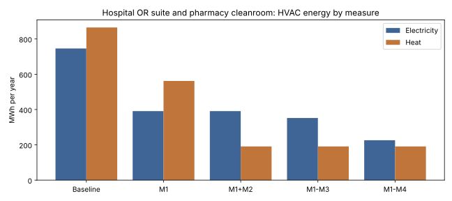
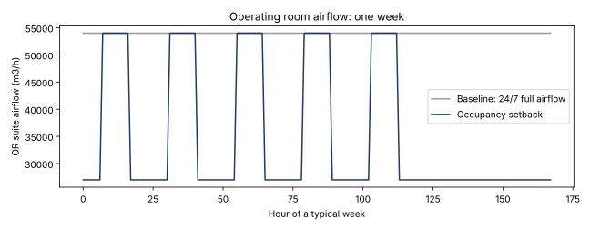

# Smart HVAC Energy Optimisation for Hospital Critical Rooms in Bern, with Brick Schema

A Brick Schema model of a representative hospital in the Bern region, focused on its
most energy-intensive HVAC: an **operating room (OR) suite** and a **hospital pharmacy cleanroom**.
The analysis finds the critical rooms through SPARQL, detects wasteful operation and
quantifies savings, **without compromising overpressure, filtration or hygiene**.

> Technical case study by Amir Razmi. Site, equipment and operating data are representative
> assumptions; replace them with real BMS data to apply the method to a real hospital.

## The facility (representative)

| System | Serves | Assumption |
|---|---|---|
| AHU-OR | 6 operating rooms with low-turbulence displacement (laminar) ceilings | 9,000 m³/h per OR, 54,000 m³/h total, terminal HEPA |
| AHU-PH | Hospital pharmacy cleanroom, aseptic preparation, GMP grade C background | 4,000 m³/h, terminal HEPA |
| Both | Run-around coil heat recovery 45 %, steam humidifier, SFP 2.5 kW per m³/s | Running at full airflow 24/7 |
| Use | ORs weekdays 07–17, pharmacy weekdays 06–18 | Rooms in use only 30–36 % of hours |
| Prices | Electricity CHF 0.20/kWh, heat CHF 0.12/kWh | Assumption |

## Automated findings

| AHU | Finding | Evidence | Measure |
|---|---|---|---|
| OR and pharmacy | Full airflow 24/7 | Rooms used only 30–36 % of hours | Occupancy-based setback, overpressure maintained |
| OR and pharmacy | Low heat recovery | Run-around coil 45 % | High-efficiency run-around coil (~70 %), no air mixing |
| OR and pharmacy | High fan power | SFP 2.5 kW per m³/s | EC fans, lower-pressure-drop pre-filters |
| Both | Humidification | Steam humidification below 5 °C outdoors | Dew-point based control where the hygiene concept allows |

## Results: measure stack

| Step | Electricity (MWh/a) | Heat (MWh/a) | Cost (kCHF/a) | Saving |
|---|---|---|---|---|
| Baseline | 746 | 865 | 253 | – |
| M1 Occupancy setback (OR to 50 %, pharmacy to 60 %) | 391 | 562 | 146 | 41 % |
| M2 + Heat recovery to 70 % | 391 | 191 | 101 | 64 % |
| M3 + EC fans, SFP 1.8 | 352 | 191 | 93 | 66 % |
| M4 + Dew-point humidity control | 226 | 191 | 68 | **74 %** |

**Bottom line:** about **1,200 MWh and CHF 185,000 per year** less energy for two AHUs, mainly by
not running operating rooms at full airflow when they are empty. Fan power falls with the cube
of airflow, so halving the airflow at night cuts fan power by almost 90 % in those hours.




## Patient safety comes first

Every measure keeps the hygiene functions intact:
- **Setback keeps overpressure** to the corridor, so no contaminated air enters the OR or cleanroom; full airflow resumes before use (recovery time validated).
- **Run-around coils** recover heat without mixing exhaust and supply air (no cross-contamination, unlike some rotary wheels).
- **Humidity bands** are only widened where the hospital hygiene concept allows.

## Standards and guidance

| Topic | Reference | Use in this study |
|---|---|---|
| Ventilation of medical rooms, Switzerland | SWKI VA105-01 (room classes, reduced operation with overpressure) | OR setback logic |
| Hygiene of ventilation systems | SWKI VA104-01 | Heat recovery without air mixing, maintenance |
| Pharmacy cleanroom | EU GMP Annex 1, ISO 14644 | Grade C background, recovery before use |
| Ventilation and air-conditioning | SIA 382/1 | Fan power (SFP) and heat recovery |
| Energy law | Cantonal energy laws based on MuKEn | Efficiency expectations |

Exact limits (airflows, room classes, recovery times) must be taken from the current
editions and the hospital's hygiene concept for a real project.

## Repository

| File | Purpose |
|---|---|
| `model_and_energy.py` | Brick model (`model/bern_hospital.ttl`, 235 triples) and hourly AHU energy model |
| `run_analysis.py` | SPARQL room discovery, rule checks, measure stack, charts |
| `results/` | Findings, measures, charts |

```bash
pip install -r requirements.txt
python run_analysis.py
```

## Limitations

First-order steady-state model; synthetic Bern climate; humidification is an approximate
temperature-based estimate (real projects need humidity data); no costs for the measures yet.
Results show the order of magnitude and ranking of measures, not guaranteed savings.

## Author

**Amir Razmi**: HVAC and thermal systems engineer for critical facilities (pharma cleanrooms, hospitals, data centres), energy optimisation, CFD and semantic building data.
[LinkedIn](https://www.linkedin.com/in/amir-razmi-phd-63194330) · [GitHub](https://github.com/amirrazmi)

License: MIT
